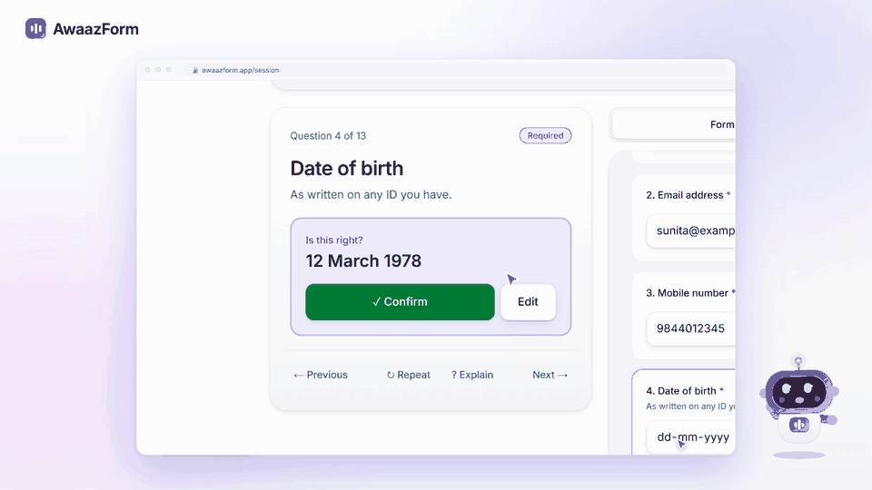
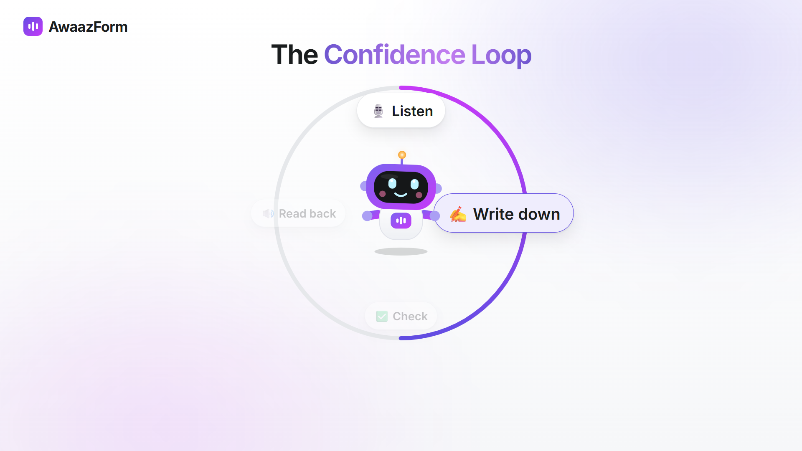
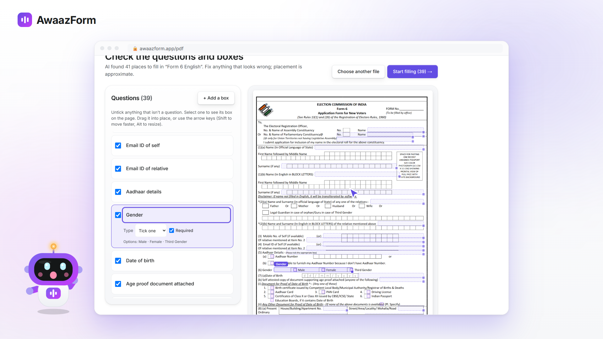
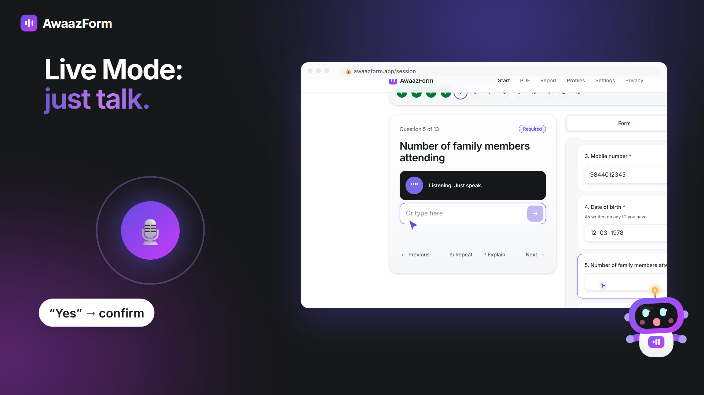
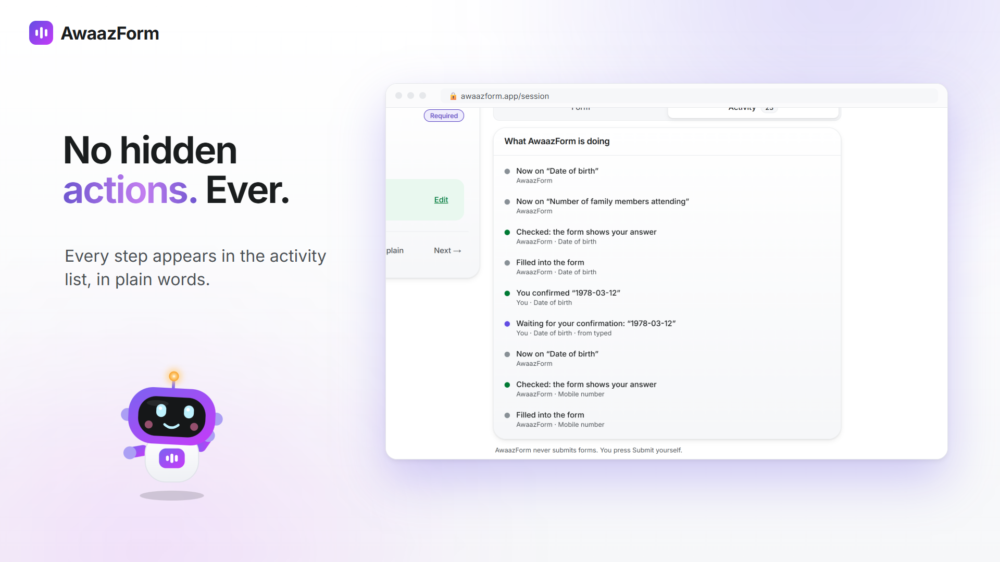
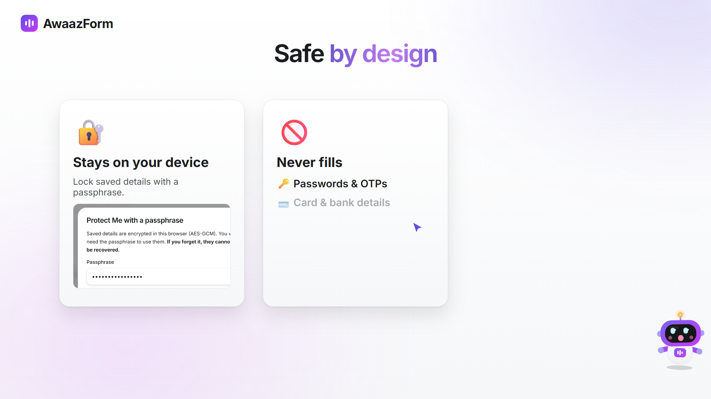
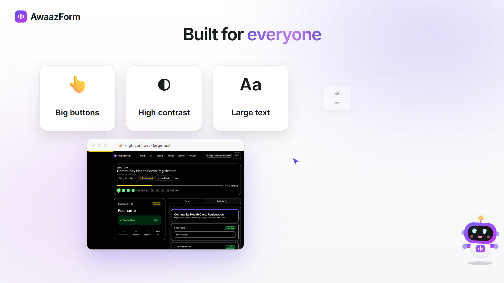

<p align="center">
  
</p>

<h1 align="center">AwaazForm</h1>

<p align="center">
  <b>Your voice. Your form. Your access.</b><br />
  Fill Google Forms and PDFs by talking. Every answer is read back and filled only after you say yes.
</p>

<p align="center">
  <a href="https://github.com/sweet-meenu/awaazform/releases/download/v0.1.0/awaazform-explainer.mp4"></a>
</p>

<p align="center">
  
  
  
  
</p>

<p align="center">
  
</p>

---

## The Confidence Loop

Bolu **listens**, **writes down** what you said, **checks** it, and **reads it back**. Nothing touches the form until you confirm, and then Bolu verifies that the value really landed.

<p align="center">
  
</p>

## What it does

<table>
  <tr>
    <td width="50%"><br /><b>Printed PDFs too.</b> AI finds the questions, you nudge the boxes into place, AwaazForm writes the answers and ticks the boxes. The file never leaves your browser.</td>
    <td width="50%"><br /><b>Live Mode.</b> Hands-free and off by default. Say "yes", "next" or "repeat" (or the Hindi equivalents), or interrupt at any time.</td>
  </tr>
  <tr>
    <td width="50%"><br /><b>No hidden actions.</b> Every step appears in a plain-language activity list.</td>
    <td width="50%"><br /><b>Safe by design.</b> Saved details stay on your device, optionally locked with a passphrase (AES-GCM). It never fills passwords, OTPs or payment details.</td>
  </tr>
</table>

<p align="center">
  <br />
  <sub>Big targets · high contrast · large text · Hindi · full keyboard control · reduce motion</sub>
</p>

## Guarantees

- **It never submits.** You press Submit yourself.
- **Only you can confirm.** The model can propose an answer but has no tool to confirm it. Writes go through one gate, `SessionController.confirm()`, which only the UI calls.
- **Your data stays private.** Personal data stays in the browser. The Groq key is used only on the server.

## Quick start

```bash
corepack enable
pnpm install
cp apps/web/.env.example apps/web/.env.local   # add your GROQ_API_KEY
pnpm dev                                       # http://localhost:3000
```

Without a key the app still works: you type your answers, and read-back uses the browser's voice.

| Command | Purpose |
|---|---|
| `pnpm test` | Core unit tests (Vitest) |
| `pnpm --filter web test:e2e` | Session and PDF end-to-end tests (needs a running server) |
| `pnpm --filter web test:a11y` | axe-core WCAG 2.2 AA audit |

## Deploy on Vercel

Import the repo, set **Root Directory** to `apps/web`, and add the variables from [`.env.example`](apps/web/.env.example). Vercel detects Next.js and pnpm on its own.

## Project layout

```
packages/core   types, validators, safety rules, session reducer, confirm gate, tool runner
apps/web        Next.js app: session, PDF, profiles, report, settings, API routes
media           the explainer video, rendered from code (see media/README.md)
example_forms   real test forms (ECI Form 6)
```

## Status

**Working:** the demo form session, fillable and printed PDFs, Live Mode, profiles, the readiness report, and the English and Hindi interface. axe-core reports no critical or serious violations on any route.

**Not yet:** the Chrome extension for live Google Forms, Devanagari text inside PDFs, and a manual screen-reader pass.

**Out of scope by design:** auto-submit, logins, payments, CAPTCHAs, sites other than Google Forms, and scanned PDFs.

---

<p align="center">
  <br />
  <sub>Team <b>CodeKweens</b> · Katathon 6.0 · Problem Statement 402</sub>
</p>
