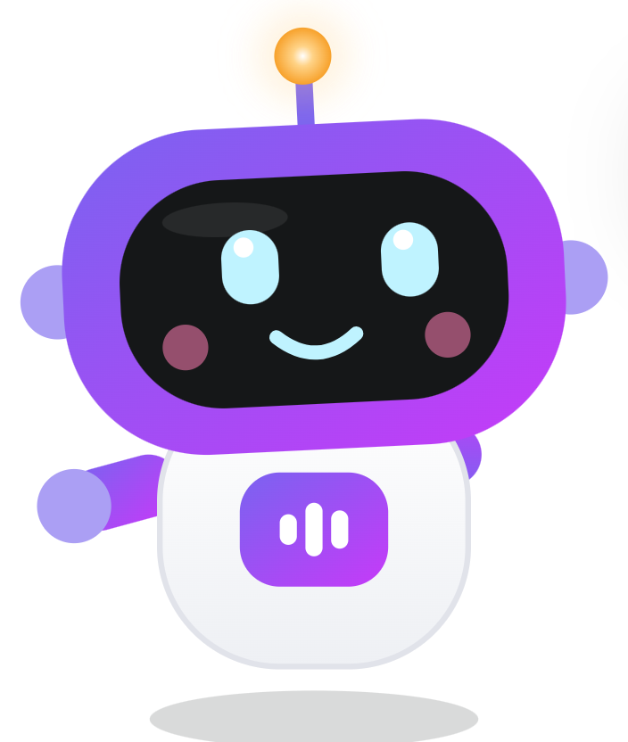
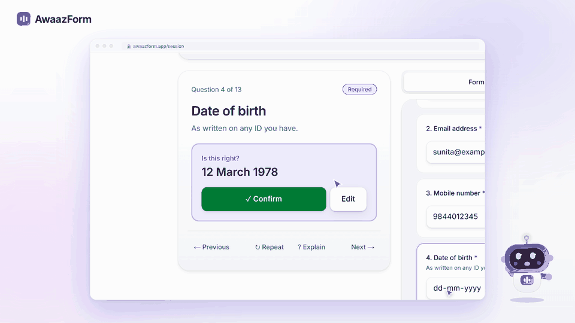
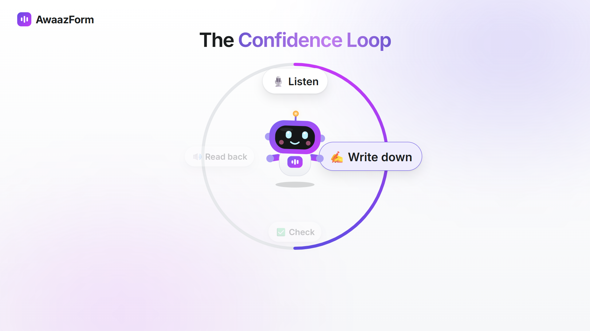
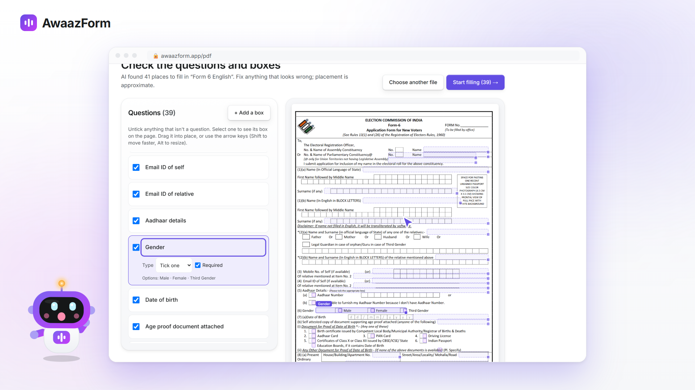
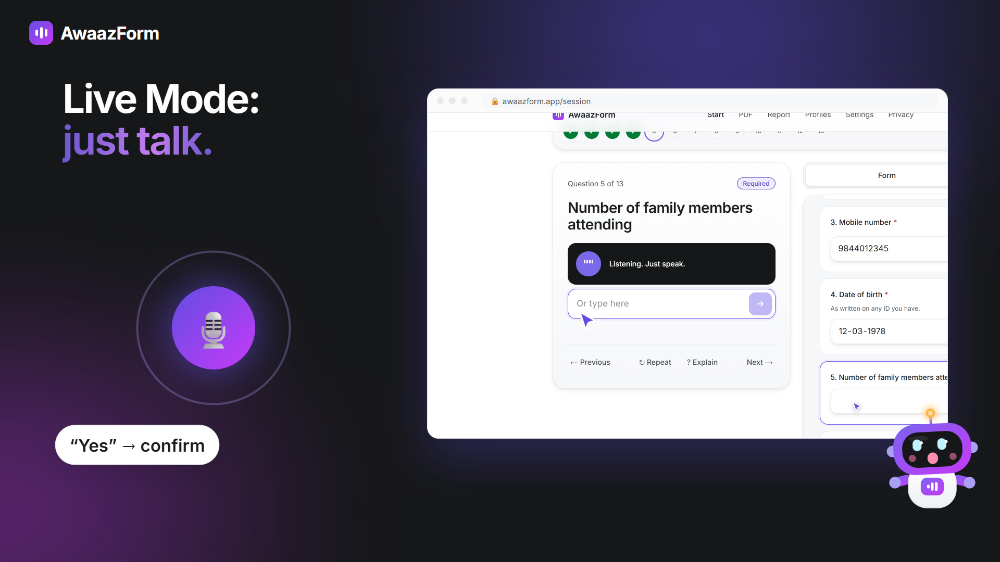
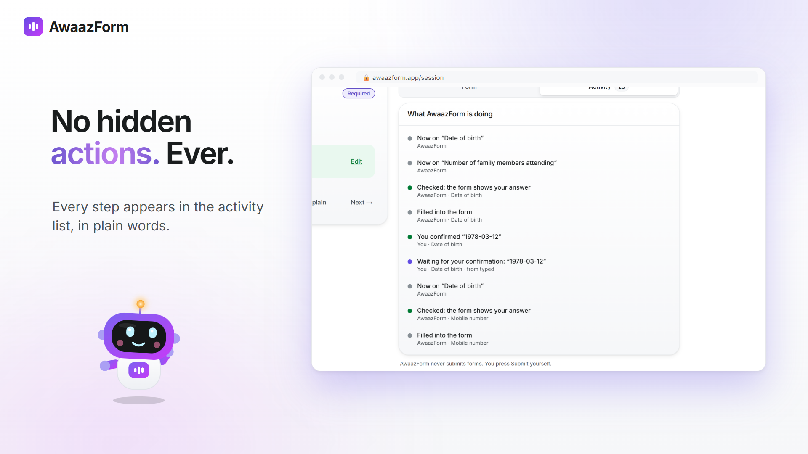
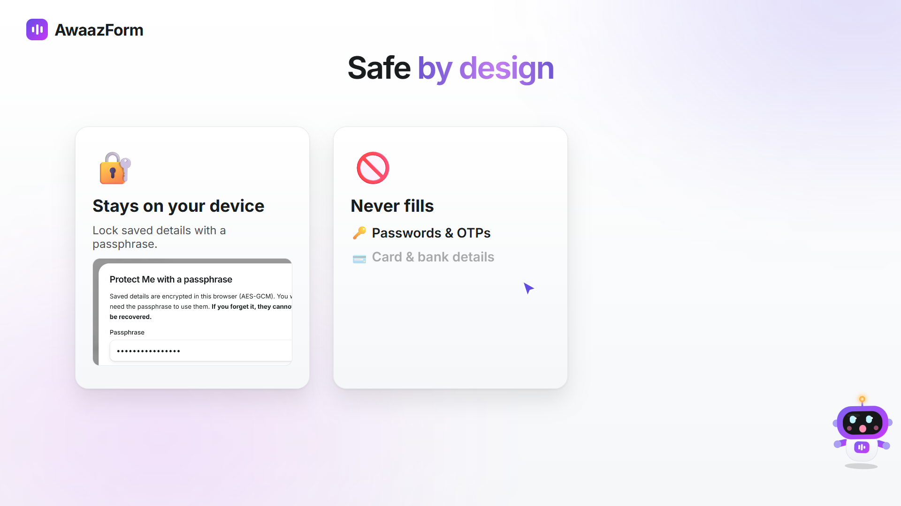
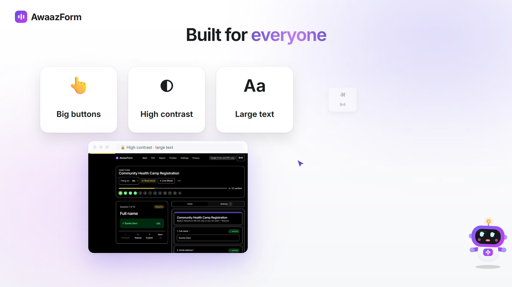

<p align="center">
  
</p>

<h1 align="center">AwaazForm</h1>

<p align="center">
  <b>Your voice. Your form. Your access.</b><br />
  Fill Google Forms, Microsoft Forms, PDFs and Word files by talking, in English and 12 Indian languages.<br />Every answer is read back and filled only after you say yes.
</p>

<p align="center">
  <a href="https://awaazform.vercel.app"></a>
  <a href="https://github.com/sweet-meenu/awaazform/releases/download/v0.1.0/awaazform-explainer.mp4"></a>
</p>

<p align="center">
  
  
  
  
</p>

<p align="center">
  
</p>

---

## The Confidence Loop

**Install on Android:** open AwaazForm in Chrome or Edge and tap **Install app** in the bottom invitation (also available in Settings). Includes offline access to saved work, launcher shortcuts and sharing forms/documents into the app. Voice and AI still need internet. See [PWA support and testing](apps/web/PWA.md).

Bolu **listens**, **writes down** what you said, **checks** it, and **reads it back**. Nothing touches the form until you confirm, and then Bolu verifies that the value really landed.

<p align="center">
  
</p>

## What it does

**Paste a Google Form or Microsoft Form link** (short `forms.gle` / `forms.office.com/r/…` links or long ones, with or without `https://`). AwaazForm reads the public form, you answer each question by voice or text, and **Open in Google Forms** opens the real form with your confirmed answers already filled in, across every section. Microsoft Forms get a pre-filled link when the form's owner allows it, and a copy-your-answers list when they don't. You check it and press Submit. No install, and it works on phones.

**Upload a PDF or a Word file** on the Documents page. Fillable and printed PDFs, and `.docx` forms with `Name: ______` blanks, ☐ option boxes, empty table cells or Word content controls. Everything is filled in your browser and downloaded.

**Or use the browser extension** ([`apps/extension`](apps/extension), downloadable from the site's Extension page). Bolu, our robot, waits in the corner of Google Forms, Microsoft Forms and ordinary web forms: talk to him, check each answer, and he types it into the real form.

**Every language, everywhere.** The whole interface, voice commands and read-backs work in English, हिन्दी, বাংলা, मराठी, తెలుగు, தமிழ், ગુજરાતી, اردو (right to left), ಕನ್ನಡ, മലയാളം, ਪੰਜਾਬੀ, অসমীয়া and नेपाली: the Indian languages Whisper understands.

**Security you can explain.** Saved details use envelope encryption (AES-256-GCM) and can be unlocked with a passkey: fingerprint, face or security key, with the secret computed in your device's secure hardware (WebAuthn PRF). Sessions and files are encrypted at rest and deleted after 24 hours. A privacy shield swaps emails, phone and ID numbers for placeholders before anything reaches the AI. The API answers only this site and the extension.

**Live Mode is a conversation.** One sentence can answer several questions ("I'm Asha, my email is …"), you can correct an earlier answer ("actually, change my email"), and option questions take the answer the way people say it: "the second one", "दूसरा", "पहिला", "option B", "I'm a student", or a tap on the option.

<table>
  <tr>
    <td width="50%"><br /><b>Printed PDFs too.</b> AI finds the questions, you nudge the boxes into place, AwaazForm writes the answers and ticks the boxes. The file never leaves your browser.</td>
    <td width="50%"><br /><b>Live Mode.</b> Hands-free and off by default. Say "yes", "next" or "repeat" (or "हाँ"/"आगे", or Marathi "हो"/"पुढे"), or interrupt at any time.</td>
  </tr>
  <tr>
    <td width="50%"><br /><b>No hidden actions.</b> Every step appears in a plain-language activity list.</td>
    <td width="50%"><br /><b>Safe by design.</b> Saved details stay on your device, optionally locked with a passphrase (AES-GCM). It never fills passwords, OTPs or payment details.</td>
  </tr>
</table>

<p align="center">
  <br />
  <sub>Big targets · high contrast · large text · Hindi · full keyboard control · reduce motion</sub>
</p>

## Guarantees

- **It never submits.** You press Submit yourself.
- **Only you can confirm.** The model can propose an answer but has no tool to confirm it. Writes go through one gate, `SessionController.confirm()`, which only the UI calls.
- **Your data stays private.** Personal data stays in the browser. The Groq key is used only on the server.

## Quick start

This branch (`alternate`) runs as two apps: the **Next.js** interface and a **FastAPI** API (`backend/`). Next.js proxies `/api/*` to the API, so the browser still talks to one origin.

```bash
corepack enable && pnpm install
cd backend && uv sync && cp .env.example .env && cd ..   # add your GROQ_API_KEY to backend/.env
(cd backend && uv run python -m app.download)            # optional: fetch every local voice now (~2 GB)
pnpm dev:all                                             # API :8000 + web :3000 (http://localhost:3000)
pnpm demo                                                # the same with a production build: smoother for presenting
```

Speech output runs **on your machine**: Kokoro for English and Hindi, Meta's MMS-TTS for Bengali, Marathi, Telugu, Tamil, Gujarati, Urdu, Kannada, Malayalam, Punjabi and Assamese (Nepali uses the Hindi voice). Every device then hears the same voice, even browsers with no Indian-language voices. Speech-to-text, the assistant and question translation still use Groq. Without a key the app still works: you type your answers, and read-back uses the local voices.

For a demo, set `TTS_PRELOAD` in `backend/.env` to the languages you will show, so they are loaded at startup. `GET /api/health` lists what is ready.

| Command | Purpose |
|---|---|
| `pnpm test` | Core unit tests (Vitest) |
| `pnpm --filter web test:e2e` | Session, options, PDF, Google Form, Microsoft Form, Word and extension content-script tests (needs a running server) |
| `pnpm --filter web test:a11y` | axe-core WCAG 2.2 AA audit |
| `pnpm --filter web test:extension` | Loads the unpacked extension and fills a live Google Form (needs Playwright's full Chromium) |

The e2e scripts use the installed Edge by default; set `BROWSER_CHANNEL=` (empty) to use Playwright's own Chromium instead.

### The extension

Download it from `/extension`, or run `node apps/extension/build.mjs` (set `AWAAZ_SERVER` to your deployment). Open `chrome://extensions` (or `edge://extensions`), turn on Developer mode, choose **Load unpacked** and pick the folder. See [`apps/extension/README.md`](apps/extension/README.md).

### Translations

`node apps/web/scripts/translate.mjs` regenerates `apps/web/lib/i18n/locales/*.json` from `en.ts` with Groq, only for strings that changed, checking placeholders and tags. Machine translations: a native speaker's review is welcome.

## Deploy on Vercel

Live at **[awaazform.vercel.app](https://awaazform.vercel.app)** (from `main`, where the API is Next.js route handlers). This branch needs the FastAPI service running somewhere too: deploy `backend/` (any host that runs Python; the local voices want ~2 GB RAM), then set `BACKEND_URL` on the web app to its address and `ALLOWED_ORIGINS` on the API to the web app's.

## Project layout

```
packages/core   types, validators, safety rules, session reducer, confirm gate, tool runner
apps/web        Next.js app: session, Google/Microsoft Form link, PDF, Word, profiles, report, settings (proxies /api/* to backend)
backend         FastAPI: Groq speech-to-text and chat, translation, PDF question finding, safe form fetching, local voices
apps/extension  Chrome/Edge MV3 extension: Bolu's in-page widget (esbuild; zip served from /downloads)
media           the explainer video, rendered from code (see media/README.md)
example_forms   real test forms (ECI Form 6)
```

## Status

**Working:** Google and Microsoft Forms by link, fillable and printed PDFs, Word (.docx) forms, the Bolu browser extension, Live Mode with multi-answer turns and corrections, passkey-protected profiles, the readiness report, and the interface in 13 languages. axe-core reports no critical or serious violations on any route.

**Not yet:** pre-filled links for Microsoft Forms whose owner hasn't allowed them (you copy answers across, or use the extension), Devanagari text inside PDFs, old `.doc` files, extension store packaging, and a manual screen-reader pass. Forms that need a sign-in, and grid, file-upload and "Other" answers, are left for you to complete on the form.

**Out of scope by design:** auto-submit, logins, payments, CAPTCHAs, and scanned PDFs.

---

<p align="center">
  <br />
  <sub>Team <b>CodeKweens</b> · Katathon 6.0 · Problem Statement 402</sub>
</p>
